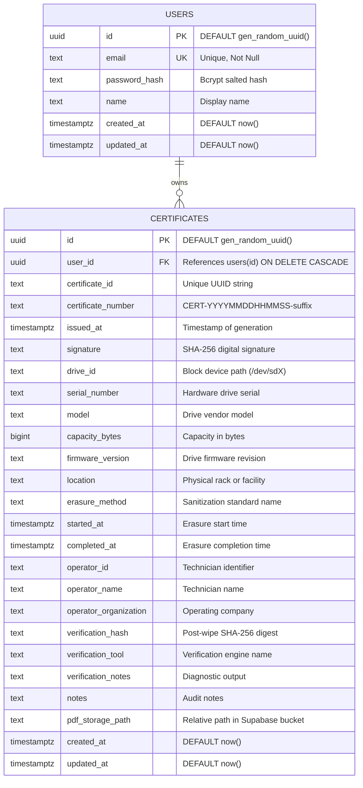

# Cloud Backend, API & Database Specification

## 1. Overview

The **BitWiperz Cloud Backend** (`backend/`) is a microservice designed for multi-tenant data sanitization attestation, digital certificate issuance, and compliance auditing. It acts as the centralized system of record for all disk wiping operations performed across distributed field devices.

### Technology Stack
* **Runtime**: Node.js 20+ (ES Modules)
* **Framework**: Express 5.x with TypeScript
* **Database & Persistence**: Supabase (PostgreSQL 15+)
* **Object Storage**: Supabase Storage (Private S3-compatible bucket)
* **Authentication**: Stateless JSON Web Tokens (JWT) with bcrypt password hashing
* **Document Engine**: `pdf-lib` for programmatic vector PDF generation

---

## 2. Database Schema (PostgreSQL / Supabase)

The database schema is structured into two primary relational entities: `users` and `certificates`.



### 2.1. Performance & Query Indexing Strategy
To optimize query throughput for high-volume ITAD facilities:
* `idx_users_email`: B-tree index on `users(email)` for sub-millisecond authentication lookups.
* `idx_certificates_user`: Index on `certificates(user_id)` supporting fast multi-tenant pagination.
* `idx_certificates_number`: Unique lookup index for compliance audits verifying specific certificate numbers.
* `idx_certificates_issued_at`: Descending index for timeline sorting and chronological audit exports.

---

## 3. Cryptographic Verification & Signature Generation

To ensure non-repudiation and prevent certificate tampering, each issued certificate carries an immutable SHA-256 cryptographic signature.

### 3.1. Signature Calculation Routine
Before database insertion, a canonical JSON payload is constructed containing all immutable metadata:
```typescript
const signaturePayload = JSON.stringify({
  ...metadata,
  certificateId,
  certificateNumber,
  issuedAt: issuedAt.toISOString(),
});

const signature = createHash('sha256').update(signaturePayload).digest('hex');
```

Any modification to drive serials, capacities, operator identity, or timestamps will result in a signature mismatch upon compliance verification.

---

## 4. REST API Specification

### 4.1. Base URL & Common Headers
* **Base URL**: `http://localhost:3000/api` (or configured production host)
* **Content-Type**: `application/json`
* **Authorization**: `Bearer <JWT_TOKEN>` (for protected endpoints)

---

### 4.2. Authentication Endpoints

#### `POST /api/auth/register`
Registers a new technician or organization account.

* **Request Body**:
  ```json
  {
    "email": "technician@itad-facility.com",
    "password": "SecurePassword123!",
    "name": "Alex Mercer"
  }
  ```
* **Response (201 Created)**:
  ```json
  {
    "token": "eyJhbGciOiJIUzI1NiIsInR5cCI6IkpXVCJ9...",
    "user": {
      "id": "c3e1b782-96cb-4b36-b631-0498a445d4a1",
      "email": "technician@itad-facility.com",
      "name": "Alex Mercer"
    }
  }
  ```

#### `POST /api/auth/login`
Authenticates existing credentials and issues a signed JWT.

* **Request Body**:
  ```json
  {
    "email": "technician@itad-facility.com",
    "password": "SecurePassword123!"
  }
  ```
* **Response (200 OK)**:
  ```json
  {
    "token": "eyJhbGciOiJIUzI1NiIsInR5cCI6IkpXVCJ9...",
    "user": {
      "id": "c3e1b782-96cb-4b36-b631-0498a445d4a1",
      "email": "technician@itad-facility.com",
      "name": "Alex Mercer"
    }
  }
  ```

#### `GET /api/auth/me` *(Protected)*
Retrieves active session details for the authenticated user.

* **Headers**: `Authorization: Bearer <token>`
* **Response (200 OK)**:
  ```json
  {
    "user": {
      "id": "c3e1b782-96cb-4b36-b631-0498a445d4a1",
      "email": "technician@itad-facility.com",
      "name": "Alex Mercer"
    }
  }
  ```

---

### 4.3. Certificate & Erasure Endpoints

#### `POST /api/certificates` *(Protected)*
Submits metadata for a completed erasure operation. Triggers cryptographic signature calculation, database persistence, and vector PDF compilation.

* **Request Body**:
  ```json
  {
    "driveId": "/dev/nvme0n1",
    "serialNumber": "S439NF0M128942K",
    "model": "Samsung 980 PRO 1TB",
    "capacityBytes": 1000204886016,
    "firmwareVersion": "5B2QGXA7",
    "location": "Rack 4 - Bay 12",
    "erasureMethod": "NVMe Secure Erase (Sanitize)",
    "startedAt": "2026-10-24T14:10:00.000Z",
    "completedAt": "2026-10-24T14:15:32.000Z",
    "operator": {
      "id": "OP-8492",
      "name": "Alex Mercer",
      "organization": "BitWiperz Data Services"
    },
    "verification": {
      "hash": "e3b0c44298fc1c149afbf4c8996fb92427ae41e4649b934ca495991b7852b855",
      "tool": "BitWiperz Verification Engine v2.0",
      "notes": "Sampled 2048 sectors at start, middle, and end. All null bytes verified."
    },
    "notes": "Server decommissioned per ISO 27001 protocol."
  }
  ```
* **Response (201 Created)**:
  ```json
  {
    "certificateId": "8b5f3a02-1279-4a92-bf31-64d567c9c0f9",
    "certificateNumber": "CERT-20261024141600-00nvme",
    "issuedAt": "2026-10-24T14:16:00.000Z",
    "signature": "d4735e3a265e16eee03f59718b9b5d03019c07d8b6c51f90da3a666eec13ab35",
    "driveId": "/dev/nvme0n1",
    "model": "Samsung 980 PRO 1TB",
    "serialNumber": "S439NF0M128942K",
    "capacityBytes": 1000204886016,
    "erasureMethod": "NVMe Secure Erase (Sanitize)",
    "startedAt": "2026-10-24T14:10:00.000Z",
    "completedAt": "2026-10-24T14:15:32.000Z",
    "operator": {
      "name": "Alex Mercer",
      "id": "OP-8492",
      "organization": "BitWiperz Data Services"
    }
  }
  ```

#### `GET /api/certificates` *(Protected)*
Lists issued certificates owned by the authenticated tenant.

* **Query Parameters**:
  * `limit` *(optional, default: 50)*: Number of records to return.
  * `offset` *(optional, default: 0)*: Pagination offset.
* **Response (200 OK)**:
  ```json
  [
    {
      "certificateId": "8b5f3a02-1279-4a92-bf31-64d567c9c0f9",
      "certificateNumber": "CERT-20261024141600-00nvme",
      "issuedAt": "2026-10-24T14:16:00.000Z",
      "signature": "d4735e3a265e16eee03f59718b9b5d03019c07d8b6c51f90da3a666eec13ab35",
      "driveId": "/dev/nvme0n1",
      "model": "Samsung 980 PRO 1TB",
      "serialNumber": "S439NF0M128942K",
      "erasureMethod": "NVMe Secure Erase (Sanitize)"
    }
  ]
  ```

#### `GET /api/certificates/:certificateId` *(Protected)*
Retrieves full details of a specific certificate.

#### `GET /api/certificates/:certificateId/pdf` *(Protected)*
Streams the generated, cryptographically stamped PDF document directly to the client (`Content-Type: application/pdf`). If already archived in Supabase Storage, it streams from object storage; otherwise, it dynamically generates the document on the fly.

---

## 5. Automated PDF Document Generation Pipeline

The certificate generator in `backend/src/services/certificateService.ts` constructs audit-ready compliance documents using `pdf-lib`:
* **Standard Dimensions**: US Letter (`[612, 792]` points).
* **Styling**: Modern dark slate headers (`rgb(0.15, 0.15, 0.18)`), crisp typography (Helvetica & Helvetica-Bold), and subtle border dividers.
* **Security Watermark**: Subtle background certificate number (`opacity: 0.25`) printed across the canvas to impede physical photocopier tampering.
* **Multi-Attempt Resilience**: PDF upload to Supabase Storage incorporates exponential backoff retries (up to 3 attempts with progressive delay) to guarantee zero loss of audit artifacts during transient network interruptions.
