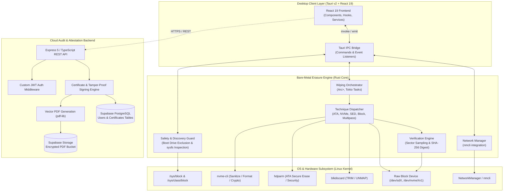
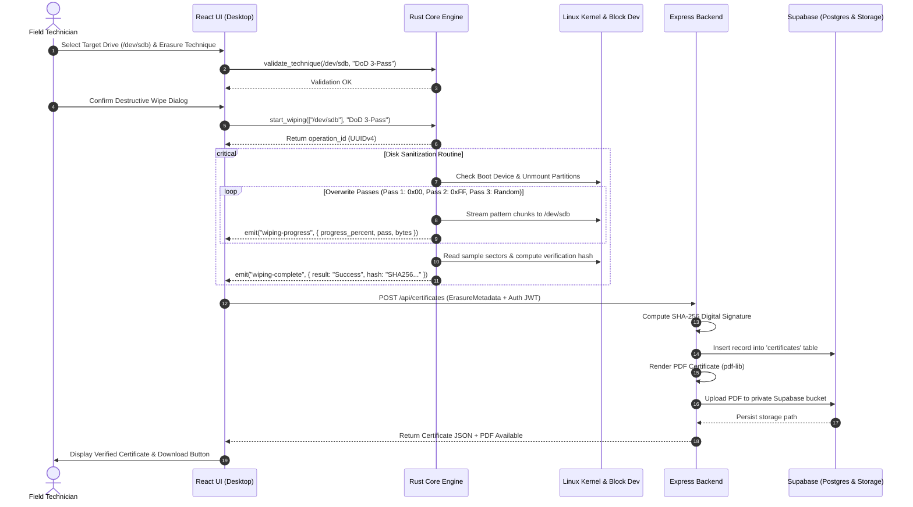

# BitWiperz — System Architecture & Design Specification

## 1. System Overview

**BitWiperz** is a dual-tier, certified data sanitization and asset decommissioning platform designed for high-security enterprise environments, IT Asset Disposition (ITAD) facilities, and field technicians. It provides cryptographically verified, irreversible data erasure across a broad spectrum of storage media (NVMe SSDs, SATA SSDs, legacy magnetic HDDs, and removable flash media) complying with global data sanitation standards including **NIST SP 800-88 Rev. 1**, **DoD 5220.22-M**, and **IEEE 2883-2022**.

The platform is structured into two primary components:
1. **Desktop Client & Bare-Metal Engine (`desktop/` & `desktop/src-tauri/`)**: A cross-platform desktop application built with **Tauri v2**, **Rust**, and **React 19 / TypeScript**. The Rust core executes with elevated privileges (`sudo`/root) to interface directly with the Linux kernel block layer (`/sys/block`), ATA controllers (`hdparm`), NVMe controllers (`nvme-cli`), and raw character/block device files.
2. **Cloud Attestation & Audit Backend (`backend/`)**: An **Express 5 / TypeScript** microservice backed by **Supabase (PostgreSQL & Encrypted Storage)**. It manages multi-tenant operator authentication, cryptographic record storage, automated vector PDF certificate generation, and audit trail verification.

---

## 2. End-to-End System Architecture



---

## 3. Component Deep Dive

### 3.1. Bare-Metal Rust Engine (`src-tauri/`)

The desktop runtime is built with **Tauri v2** to ensure minimal memory footprint, zero Chromium overhead, and native C-level system call capabilities through Rust.

#### A. Wiping Orchestrator (`src/wiping/mod.rs`)
* **Concurrency Model**: Implemented using the **Tokio asynchronous runtime**. Each selected target drive is allocated an independent asynchronous task (`tokio::spawn`), enabling concurrent, multi-drive wiping without thread starvation.
* **Shared State**: Operation state is encapsulated in `WipingOrchestrator` using `Arc<RwLock<HashMap<String, (Vec<JoinHandle<WipingStatus>>, CancellationToken)>>>`. This guarantees lock contention is minimized to read locks during telemetry queries, while write locks only occur on task creation and teardown.
* **Cooperative Cancellation**: When an operator issues a cancel request, the orchestrator triggers the drive's specific `tokio_util::sync::CancellationToken`. Running passes check `cancel_token.is_cancelled()` between block read/writes and abort instantly without leaving dangling locks or orphaned processes.
* **Real-Time Telemetry**: Emits high-frequency status messages (`wiping-progress`, `wiping-complete`) over Tauri's event bus to the React UI, broadcasting percentage, current pass number, total passes, bytes processed, and timestamp.

#### B. Drive Detection & Safety Guard (`src/drive_detection.rs` & `src/wiping/device.rs`)
A common risk in disk-wiping software is accidentally destroying the host operating system or the USB boot drive running the tool. BitWiperz implements a multi-layered safety guard:
1. **Current Executable Identification**: Resolves `std::env::current_exe()` to find the active running executable path.
2. **Mount Point Mapping**: Inspects `/proc/mounts` and `/sys/class/block` to determine which block device hosts the running binary (`get_app_device_path()`) and extracts its root parent device name (`get_base_device_name()`).
3. **Automatic Exclusion**: The app drive, root partitions (`/`), boot partitions (`/boot`), and loop/RAM devices (`loop*`, `ram*`) are filtered out completely from the UI selection list.
4. **Pre-Flight Unmount Verification**: Before sector modification begins, `unmount_device()` automatically issues unmount commands on all mounted child partitions to prevent file system corruption and I/O locking.

#### C. Technique Compatibility Matrix & Dispatcher (`src/wiping/types.rs`)
The engine dynamically probes drive characteristics via sysfs flags:
* **Rotational Flag (`/sys/block/<dev>/queue/rotational`)**: `0` indicates solid-state media (SSD/NVMe); `1` indicates magnetic rotational media (HDD).
* **Discard Granularity (`/sys/block/<dev>/queue/discard_granularity`)**: If `> 0`, the device natively supports block discard (TRIM/UNMAP).
* **Protocol Classification**: Distinguishes SATA (`/dev/sd*`) from NVMe (`/dev/nvme*n*`).

If a user selects an incompatible technique (e.g., ATA Secure Erase on an NVMe device or Block Erase on a magnetic HDD), the engine rejects the operation at the validation stage before executing any destructive commands.

---

### 3.2. Desktop Frontend Layer (`desktop/src/`)

Built with **React 19**, **Vite**, and **TypeScript**, the interface is optimized for industrial/field use:
* **Device Selection View (`SelectDevices.tsx`)**: Displays detected drives with health status, capacity, model, vendor, and serial numbers. Features safety badges and multi-selection for batch wiping.
* **Technique Configuration (`ErasureMethod.tsx`)**: Recommends appropriate algorithms (e.g., NIST 800-88 Purge via NVMe Sanitize for enterprise SSDs; DoD 5220.22-M 3-Pass for HDDs).
* **Progress Monitor (`WipingProgress.tsx` & `WipingStatus.tsx`)**: Live visual feedback showing sector-by-sector progress, throughput, and error boundaries.
* **Field Network Manager (`NetworkSetup.tsx`)**: When operating in headless or live USB kiosk environments, field engineers can scan Wi-Fi SSIDs, supply WPA2/WPA3 passphrases, and verify internet connectivity directly inside the app using `nmcli`.

---

### 3.3. Cloud Attestation & Audit Backend (`backend/src/`)

Built with **Express 5 (ESM)**, **TypeScript**, and **Supabase**:
* **Authentication**: Stateless JWT issuance (`/api/auth/register`, `/api/auth/login`, `/api/auth/me`) using bcrypt salted password hashing (salt rounds = 10).
* **Cryptographic Attestation (`certificateService.ts`)**:
  * Deterministic certificate numbering: `CERT-YYYYMMDDHHMMSS-<driveSuffix>`.
  * Digital signature: Combines drive ID, serial number, model, capacity, timestamp, operator ID, and verification hash into a canonical JSON payload, hashed via SHA-256.
* **Vector PDF Generation (`pdf-lib`)**: Server-side rendering of compliance certificates featuring security watermarks, corporate branding, operator metadata, and SHA-256 verification hash.
* **Persistence & Storage**: Records are committed to PostgreSQL (`certificates` table), and generated PDFs are stored in a private Supabase Storage bucket with authenticated download endpoints.

---

## 4. Sequence Diagrams

### 4.1. End-to-End Erasure & Certificate Issuance Flow



---

## 5. Security & Safety Design Principles

| Pillar | Implementation Strategy |
| :--- | :--- |
| **Fail-Safe Device Protection** | Active binary inspection via `/proc/self/exe` and parent mount point tracking prevents accidental selection of host/boot partitions. |
| **Irreversibility & Compliance** | Strict adherence to standard patterns (e.g. DoD 0x00 -> 0xFF -> Random with complement checking; NVMe Cryptographic Erase master key zeroing). |
| **Auditability & Non-Repudiation** | Every certificate binds drive serial, operator details, timestamp, and SHA-256 signature into an immutable PostgreSQL record with PDF proof. |
| **Least Privilege in Cloud** | Supabase database uses Row Level Security (RLS) restricting tenants to their own organization's records, while backend uses server-side service keys for elevated PDF operations. |
| **Graceful Degradation** | If cloud connectivity is unavailable during field operations, the desktop frontend caches erasure completion data locally, allowing queued certificate generation once network connectivity is restored via `NetworkSetup`. |

---

## 6. Directory Structure Mapping

```text
bittwiper/
└── BitWiperz/
    ├── backend/                    # Express 5 + Supabase Cloud Backend
    │   ├── data/schema.sql         # PostgreSQL Database DDL & Indices
    │   ├── src/
    │   │   ├── controllers/        # Auth & Certificate HTTP Controllers
    │   │   ├── db/supabase.ts      # Supabase Admin Client Initializer
    │   │   ├── models/             # Domain Types & Database Row Types
    │   │   ├── routes/             # REST Route Definitions (/api/auth, /api/certificates)
    │   │   ├── services/           # Business Logic & PDF Generation Engine
    │   │   ├── app.ts              # Express App Configuration & Middlewares
    │   │   └── server.ts           # HTTP Server Bootstrap
    │   └── package.json
    │
    ├── desktop/                    # Tauri v2 + React 19 Client
    │   ├── src/
    │   │   ├── components/         # Status badges, Progress gauges, Erasure selector
    │   │   ├── contexts/           # Auth and Application State Contexts
    │   │   ├── pages/              # Welcome, SelectDevices, Reports, NetworkSetup, Auth
    │   │   ├── services/           # Tauri IPC Wrappers & Cloud API Consumers
    │   │   └── App.tsx             # Route Configuration
    │   ├── src-tauri/              # Rust Bare-Metal Engine
    │   │   ├── src/
    │   │   │   ├── wiping/         # ATA, NVMe, Block, Multipass, Crypto Implementations
    │   │   │   ├── drive_detection.rs # sysfs Parsing, Safety Exclusion Engine
    │   │   │   ├── network.rs      # nmcli Linux Network Controller
    │   │   │   ├── lib.rs          # Tauri Command Handlers & Invocation Bridge
    │   │   │   └── main.rs         # Application Entry Point
    │   │   └── Cargo.toml          # Tokio, Tauri, Serde, SHA-2, libc Dependencies
    │   └── package.json
    └── docs/                       # Comprehensive Architecture & Interview Documentation
```
