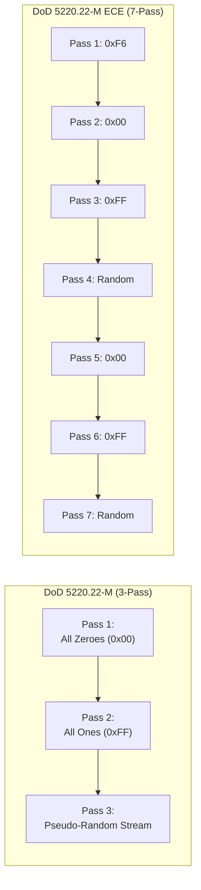

# Data Sanitization Standards & Erasure Algorithms

## 1. Introduction & Theoretical Foundations

Data sanitization is the disciplined process of rendering access to target data on storage media infeasible for a determined level of recovery effort. Simply deleting partitions, formatting file systems, or unlinking file allocation tables leaves raw data sectors completely intact and easily retrievable using standard data recovery utilities.

Furthermore, modern storage architectures present unique physical challenges:
* **Magnetic Hard Disk Drives (HDDs)**: Data is stored as magnetic domain alignments on spinning platters. High-density magnetic media historically raised concerns about magnetic force microscopy (MFM) recovery of overwritten tracks, necessitating multi-pass overwrites with varying bit patterns.
* **Solid-State Drives (NAND Flash / SSDs / NVMe)**: Solid-state storage utilizes a complex internal **Flash Translation Layer (FTL)**. The host operating system addresses logical block addresses (LBAs), which the FTL dynamically maps to physical flash memory blocks. Due to wear-leveling algorithms, over-provisioned spare blocks, and bad-block retirement, standard software overwriting across LBAs **cannot guarantee physical erasure** of data residing in unmapped or retired physical flash cells.

To address these distinct physical requirements, **BitWiperz** implements both **hardware-level firmware sanitization** and **software-level multi-pass overwriting**, adhering to internationally recognized standards:
1. **NIST SP 800-88 Rev. 1** (*Guidelines for Media Sanitization*)
2. **DoD 5220.22-M / NISPOM** (*National Industrial Security Program Operating Manual*)
3. **IEEE 2883-2022** (*Standard for Sanitizing Storage*)
4. **Peter Gutmann's Algorithm** (*Secure Deletion of Data from Magnetic and Solid-State Memory*)

---

## 2. Standards Compliance Overview

### 2.1. NIST SP 800-88 Rev. 1 Hierarchy

| Level | Definition | BitWiperz Implementation | Applicable Media |
| :--- | :--- | :--- | :--- |
| **Clear** | Logical techniques applied to sanitize data in all user-addressable storage locations for protection against simple, non-invasive data recovery techniques. | Zero Fill, Single Pass Random, Block Erase (TRIM). | All media types. |
| **Purge** | Physical or logical techniques that render target data recovery infeasible using state-of-the-art laboratory techniques. Includes internal controller-level firmware erasure. | ATA Secure Erase, NVMe Sanitize / Secure Erase, Crypto Erase (SEDs). | SATA SSDs, NVMe drives, Self-Encrypting Drives (SEDs). |
| **Destroy** | Ultimate physical destruction (degaussing, incineration, shredding) rendering media unusable. | Outside software scope; BitWiperz issues Purge certifications prior to physical recycling. | End-of-life physical assets. |

---

## 3. Algorithm Deep Dive & Implementation

### 3.1. NVMe Sanitize & NVMe Secure Erase (`nvme_erase.rs`)

Modern NVMe solid-state storage relies on standardized NVM Express command sets to execute controller-level sanitization.

#### A. NVMe Sanitize (Block Erase / Crypto Erase)
* **Standard**: NIST SP 800-88 Rev. 1 Purge.
* **Mechanism**: Instructs the NVMe controller's internal state machine to perform a physical low-level block erase across all memory blocks, including user-addressable LBAs, over-provisioned regions, and retired defect blocks.
* **Command Sequence**:
  ```bash
  # Execute NVMe Sanitize with Block Erase
  nvme sanitize /dev/nvme0n1 -a 2
  ```
* **Status Polling**: The Rust engine continuously polls the Sanitize Status Log (`nvme sanitize-log`) to monitor progress percentage until the controller reports completion or error.

#### B. NVMe Format with User Data Erase
* **Standard**: NIST SP 800-88 Rev. 1 Clear / Purge.
* **Mechanism**: Low-level formats the NVM subsystem. With `-s 1` (User Data Erase), the controller wipes all user data blocks. With `-s 2` (Cryptographic Erase), the controller erases the internal encryption key.
* **Command Sequence**:
  ```bash
  # Format with User Data Erase
  nvme format /dev/nvme0n1 -s 1 -f
  ```

---

### 3.2. ATA Secure Erase (`ata_erase.rs`)

ATA Secure Erase is an internal command defined in the ANSI ATA specification for SATA and PATA drives.

* **Standard**: NIST SP 800-88 Purge.
* **Mechanism**: The drive's internal firmware writes predetermined binary patterns to all storage sectors, including reallocated bad blocks, Host Protected Areas (HPA), and Device Configuration Overlays (DCO).
* **Implementation Protocol**:
  1. **Freeze Lock Check**: SATA drives are typically placed into a "frozen" state by the system BIOS/UEFI at boot to prevent malware attacks. BitWiperz queries `hdparm -I` to verify whether the drive is `frozen` or `not frozen`.
  2. **Temporary Security Lock**: Sets a temporary security password:
     ```bash
     hdparm --user-master u --security-set-pass bitwiper_temp /dev/sdX
     ```
  3. **Issue Erase Command**:
     ```bash
     hdparm --user-master u --security-erase bitwiper_temp /dev/sdX
     ```
  4. **Firmware Execution**: The drive firmware takes exclusive control, executing internal erasure while preventing host interrupts.

---

### 3.3. Cryptographic Erase (Crypto Erase / SED) (`crypto_erase.rs`)

* **Standard**: NIST SP 800-88 Rev. 1 Purge / IEEE 2883-2022.
* **Applicability**: Self-Encrypting Drives (SEDs) following TCG (Trusted Computing Group) Opal standards or NVMe Self-Encrypting SSDs.
* **Mechanism**:
  1. In a self-encrypting drive, data written to the media is continuously encrypted in real time by an internal cryptographic hardware ASIC using a Media Encryption Key (MEK).
  2. Cryptographic Erase overwrites, invalidates, or zeros out the MEK.
  3. Without the MEK, all data stored on the physical NAND blocks is instantly rendered into undecipherable ciphertext, mathematically impossible to decrypt even with full physical access to the flash dies.
* **Execution Time**: Almost instantaneous (< 10 seconds), irrespective of drive capacity (1TB vs 30TB).

---

### 3.4. Block Erase (TRIM / UNMAP) (`block_erase.rs`)

* **Standard**: NIST SP 800-88 Clear.
* **Mechanism**: Issues ATA TRIM or SCSI UNMAP commands across the entire range of logical block addresses using `blkdiscard`.
* **Kernel Verification**: BitWiperz inspects `/sys/block/<dev>/queue/discard_granularity`. If granularity is 0, the drive does not support hardware discard and the operation is aborted.
* **Command Sequence**:
  ```bash
  blkdiscard -v /dev/sdX
  ```
* **Effect**: Instructs the SSD FTL that all blocks contain stale data. Subsequent reads return deterministic zeroes or random data depending on drive firmware (RZAT/DRAT).

---

### 3.5. Software Multi-Pass Overwriting (`multipass.rs`)

For magnetic rotational hard drives (HDDs) or environments requiring strict multi-pass compliance, BitWiperz streams pattern buffers directly to the raw block device.



#### A. DoD 5220.22-M (3-Pass)
1. **Pass 1**: Overwrite all addressable sectors with fixed binary zeroes (`0x00`).
2. **Pass 2**: Overwrite all addressable sectors with fixed binary complement ones (`0xFF`).
3. **Pass 3**: Overwrite all addressable sectors with a cryptographically pseudo-random byte stream generated via `/dev/urandom` / `rand::thread_rng`.

#### B. DoD 5220.22-M ECE (7-Pass Extended)
Designed for higher security sanitization of magnetic storage media. Executes 7 alternating passes (`0xF6`, `0x00`, `0xFF`, `Random`, `0x00`, `0xFF`, `Random`), reducing residual magnetic signal remanence below detection thresholds.

#### C. Peter Gutmann's Algorithm (35-Pass)
* Formulated in 1996 for legacy magnetic recording schemes (MFM, RLL 1,7, RLL 2,7).
* Combines 4 random passes at the start, 27 highly specific bit sequence patterns designed to alter magnetic domain boundaries across various encoding schemes, and 4 final random passes.

---

## 4. Hardware & Technique Compatibility Matrix

| Technique | NVMe SSD | SATA SSD | Magnetic HDD | Removable USB Flash | Compliance Level |
| :--- | :---: | :---: | :---: | :---: | :--- |
| **NVMe Secure Erase** | **Yes** | No | No | No | NIST 800-88 Purge |
| **NVMe Format** | **Yes** | No | No | No | NIST 800-88 Clear/Purge |
| **ATA Secure Erase** | No | **Yes** | **Yes** | No | NIST 800-88 Purge |
| **Crypto Erase** | **Yes** | **Yes (SED)** | **Yes (SED)**| No | NIST 800-88 Purge |
| **Block Erase (TRIM)** | **Yes** | **Yes** | No | Optional | NIST 800-88 Clear |
| **DoD 5220.22-M (3-Pass)**| **Yes** | **Yes** | **Yes** | **Yes** | DoD Standard |
| **DoD 5220.22-M (7-Pass)**| **Yes** | **Yes** | **Yes** | **Yes** | DoD ECE Standard |
| **Gutmann (35-Pass)** | **Yes** | **Yes** | **Yes** | **Yes** | High Security HDD |
| **Single Pass Zero Fill** | **Yes** | **Yes** | **Yes** | **Yes** | NIST 800-88 Clear |

---

## 5. Verification & Integrity Attestation

Upon completion of physical erasure, verification is necessary to validate compliance.

### 5.1. The 100% Read Verification Bottleneck
Reading every single sector of an 8TB or 16TB enterprise drive to verify zeroes/random patterns requires 12 to 24 hours of sequential read time, significantly bottlenecking ITAD decommissioning pipelines.

### 5.2. BitWiperz Statistical Sector Sampling & SHA-256 Digest
BitWiperz employs an automated verification routine:
1. **Sample Locations**: Reads sequential blocks from the Master Boot Record / GUID Partition Table (LBA 0 to LBA 2048), mid-drive sectors, and trailing sectors at the drive boundary.
2. **Hash Generation**: Computes a continuous **SHA-256 digest** of the sampled sectors.
3. **Pattern Validation**: Confirms that non-random methods (e.g. Zero Fill, ATA Secure Erase) evaluate to null bytes throughout the sampled spaces.
4. **Attestation Binding**: The resultant `verification_hash`, timestamp, and tool metadata are embedded directly into the final tamper-proof certificate of erasure.
